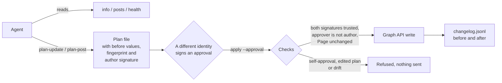

# fb-page-guard

An approval-gated Facebook Page client for AI agents. The agent can read a Page
freely, but every change goes through a plan that the agent signs as its author
and that a **different identity** must sign an approval for. The agent's own
key can't approve its own plan. If the plan is edited after it is signed, or
someone changes the Page by hand in the meantime, nothing is sent.

It came out of giving an agent API access to a small business Page instead of
driving the Facebook website, which kept hitting sign-in checks.



## What it does
- **One-time token setup.** Exchanges a short-lived user token for a long-lived
  one, takes the Page token from `/me/accounts` (following pagination), checks
  it has the `MANAGE` and `CREATE_CONTENT` tasks, confirms it with
  `/debug_token`, and stores it encrypted (Fernet, file mode 0600). A Page token
  made this way does not expire on a timer. The printed summary never contains a
  token or the app secret.
- **Reads without approval:** Page info, published posts, a health check.
- **Writes only by plan and approval.** `plan-update` and `plan-post` send
  nothing. They record the current values, drop fields that wouldn't change,
  record the author (`FBG_IDENTITY`), sign the plan with the author's Ed25519
  key, and print a 12-character fingerprint.
- **The author can't approve its own plan.** `approve` signs an approval of
  one exact plan with the reviewer's own key, after the reviewer types the
  fingerprint they read. `apply --approval <file>` sends the plan only if the
  author and approver signatures both verify against the trusted-keys file, the
  approver is a different identity from the author (case-insensitive) with a
  different key, the plan is unedited since it was signed, it is for the same
  Page, and the Page still has the values the plan was made against. The
  trusted-keys file refuses one key listed under two names.
- **Guard rails:** an allowlist of editable fields; `username`, `name` and
  category are refused because the API can't set them; `about` is limited to
  100 characters; links must be https; scheduled posts must be 10 minutes to 30
  days ahead and have a timezone.
- **Retries** on Meta's rate-limit and temporary error codes (4, 17, 32, 613,
  80001, 80004, 1, 2) with exponential backoff, up to 5 times. Permission errors
  are not retried.
- **Redaction** of `access_token`, `client_secret`, bearer values and
  token-shaped strings in every error and changelog line.
- **Changelog:** each applied write appends one JSON line with the time, the
  fingerprint, the before values and the after values.

## Quick start
Python 3.9+. HTTP uses only the standard library; the encrypted token store
needs `cryptography`, and so does signing plans and approvals.

```bash
git clone https://github.com/globe-teck/fb-page-guard && cd fb-page-guard
pip install ".[crypto]"
python3 -c "from cryptography.fernet import Fernet; print(Fernet.generate_key().decode())"
# Keep that key in your secret store, then in the shell that runs fbguard:
read -rs FBG_TOKEN_KEY && export FBG_TOKEN_KEY
export FBG_PAGE_ID=1234567890

# Once. Prompts with hidden input for the app ID, app secret and a short-lived
# user token (from the Graph API Explorer) if they aren't in the environment.
fbguard setup

# One key per identity. Each private key stays with its owner (mode 0600).
# The agent's account must not be able to read the reviewer's key.
fbguard keygen --identity page-agent --key-out ~/.fbguard/page-agent.key   # as the agent
fbguard keygen --identity alice --key-out ~/.fbguard/alice.key             # as the reviewer
# Put both printed "identity ed25519:..." lines in a trusted-keys file that the
# agent can read but not edit, for example one owned by another account.
export FBG_TRUSTED_KEYS=/etc/fbguard/trusted_keys

# The agent plans (signed as page-agent):
export FBG_IDENTITY=page-agent FBG_SIGNING_KEY=~/.fbguard/page-agent.key
fbguard health
fbguard plan-update about="Small software studio" website=https://example.com --out about.plan.json

# The reviewer reads about.plan.json and approves it under their own identity:
FBG_IDENTITY=alice FBG_SIGNING_KEY=~/.fbguard/alice.key \
  fbguard approve about.plan.json --fingerprint 3f9c0a1b2c4d --out about.approval.json

# The agent sends it:
fbguard apply about.plan.json --approval about.approval.json
```

The Meta app can stay in Development mode when the same person is an admin of
both the app and the Page. Posts made in Development mode are visible only to
people with a role on the app.

## Known limits (learned the hard way)
- Separation of identities is only as strong as where the keys live. The check
  stops an agent approving its own plan as long as the agent **cannot read any
  other identity's private key and cannot edit the trusted-keys file**. If the
  agent runs as the same OS account that holds the reviewer's key, or can
  rewrite the trusted-keys file, it can approve its own plans, and the gate is
  a workflow check rather than a control. Keep reviewer keys on another
  account or device, and the trusted-keys file read-only to the agent.
- Identities are names you choose; the tool doesn't verify who a person is,
  only that each signature matches the key listed for that name.
- Old posts that the Page published itself before the app existed can't be
  deleted (`(#200)`: not created by this app) or hidden (`(#100)`) through the
  API. Remove them by hand in the Page's activity log if Facebook offers it.
- The vanity username and the Page category are read-only through the API.
- A password change, removing the app, or losing the Page role invalidates the
  token. Run `fbguard setup` again.

## Tests
```bash
python3 -m unittest discover -s tests -t . -v
```
51 offline tests use a fake Graph API. They cover the approval checks
(including an author approving its own plan, a case variant of its name, a key
listed under two names, signing under someone else's name, untrusted
approvers, approval fields that aren't strings, plan or approval files that
aren't JSON objects, and identities with a trailing newline), drift detection, redaction, retries, token setup with pagination,
and the encrypted store. Signing needs `cryptography`. CI runs them on Python 3.9 and 3.12.

## About
AI Researcher & Founder at Globe Teck. Built with AI coding assistance. I
defined the requirements, ran the tests, and reviewed the changes. Python:
basic.

MIT License. Copyright (c) 2026 Globe Teck.
